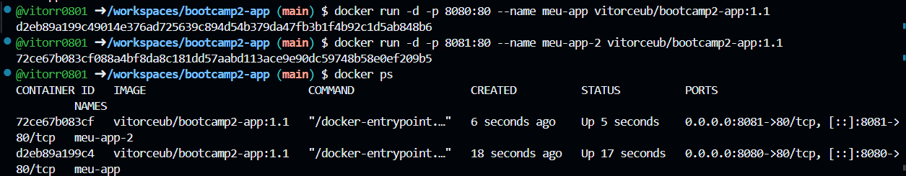

# Escalação — Explorador de Times (Etapa 02)

**Autor:** Vitor — RA 22308730 — GitHub: [vitorr0801](https://github.com/vitorr0801)

Aplicação web (HTML + CSS + JavaScript puros) para explorar times de futebol, basquete, hóquei no gelo, beisebol e futebol americano usando a API pública [TheSportsDB](https://www.thesportsdb.com/). Na Etapa 02 foram adicionados **favoritos persistidos em um banco de dados real (Supabase / PostgreSQL)** e o empacotamento da aplicação em **Docker**, publicado no Docker Hub.

## 1. Links da entrega

| Item | Link |
|------|------|
| Repositório GitHub | https://github.com/vitorr0801/bootcamp2-app |
| GitHub Pages (app online) | https://vitorr0801.github.io/bootcamp2-app/ |
| Docker Hub | https://hub.docker.com/r/vitorceub/bootcamp2-app |

## 2. Rodar com Docker (comando pronto)

```bash
docker run -d -p 8080:80 vitorceub/bootcamp2-app:1.1
```

Depois abra **http://localhost:8080**. Para parar e remover: `docker stop <nome>` e `docker rm <nome>`.

### Rodar sem Docker

Basta abrir o `index.html` no navegador (ou servir a pasta com qualquer servidor estático). Antes, configure a URL e a chave do Supabase no começo do `script.js` (seção 4).

## 3. Funcionalidades

- Busca de time por nome (ex.: Real Madrid, Lakers, Cruzeiro).
- Navegação por esporte → país → liga → equipe, com filtro por nome dentro da liga.
- **Favoritar** qualquer time dos resultados (botão ☆/★ no card).
- Seção **Meus favoritos**, carregada do banco assim que a página abre, com botão **Excluir** em cada item.
- **Anotação pessoal** em cada favorito (v1.1), salva no banco.
- Avisos (toasts) para sucesso e erro, inclusive quando o banco recusa uma operação.

## 4. Persistência de dados

- **Banco escolhido:** Supabase (PostgreSQL gerenciado), região América.
- **Acesso:** o navegador usa `supabase-js` com a **URL do projeto** e a **chave anon/public** (segura para o frontend; a chave `service_role` nunca é usada). Não é usado `localStorage`: os dados ficam no banco e aparecem em qualquer navegador/dispositivo.
- **Script da tabela:** [`banco.sql`](banco.sql) (colar no SQL Editor do Supabase).

### Estrutura da tabela `favoritos`

| Coluna | Tipo | Descrição |
|--------|------|-----------|
| `id` | bigint (identity, PK) | Identificador do registro |
| `criado_em` | timestamptz (default `now()`) | Quando foi favoritado |
| `id_time` | text, **unique**, not null | `idTeam` da TheSportsDB (impede favoritar o mesmo time duas vezes) |
| `nome_time` | text, not null | Nome do time |
| `escudo_url` | text | URL do escudo |
| `liga` | text | Liga do time |
| `esporte` | text | Esporte |
| `pais` | text | País |
| `estadio` | text | Estádio |
| `ano_fundacao` | integer | Ano de fundação |
| `anotacao` | text (máx. 500) | Anotação pessoal sobre o time (v1.1) |

### O que é salvo e como cada operação funciona

Ao favoritar, salvamos os dados principais do time vindos da API, para a lista aparecer sem nova consulta à TheSportsDB.

| Operação | Onde no app | Chamada |
|----------|-------------|---------|
| **Create** | Botão "☆ Favoritar" | `insert` na tabela `favoritos` |
| **Read** | Seção "Meus favoritos" (ao abrir a página) | `select` ordenado por `criado_em` desc |
| **Update** (v1.1) | Campo "Minha anotação" + "Salvar anotação" no favorito | `update` da coluna `anotacao` por `id` |
| **Delete** | Botão "Excluir" no item, ou "★ Favoritado" no card | `delete` por `id` |

O app confere se o `delete` realmente removeu uma linha, porque o Supabase não devolve erro quando o RLS bloqueia a exclusão (apenas 0 linhas afetadas).

### Row Level Security (RLS) — limitação conhecida

O RLS está **ativado** na tabela, com políticas **abertas para o papel `anon`** (`select`, `insert`, `update` e `delete` com `using (true)` / `with check (true)`). Isso é uma **limitação conhecida e aceita nesta etapa**: como não há login, **qualquer pessoa com a chave anon pode ler, criar, editar e apagar favoritos**, e a lista é compartilhada entre todos os visitantes. Em produção, usaríamos Supabase Auth, uma coluna `user_id` e políticas do tipo `auth.uid() = user_id`.

## 5. Docker

`Dockerfile`:

```dockerfile
FROM nginx:alpine
COPY index.html style.css script.js /usr/share/nginx/html/
EXPOSE 80
```

Comandos usados na primeira publicação (versão 1.0):

```bash
docker build -t bootcamp2-app .
docker run -d -p 8080:80 --name meu-app bootcamp2-app
docker login
docker tag bootcamp2-app vitorceub/bootcamp2-app:1.0
docker push vitorceub/bootcamp2-app:1.0
```

## 6. Sidequests

### SQ1 — `.dockerignore`

O arquivo [`.dockerignore`](.dockerignore) lista o que **não** deve ser enviado ao Docker no `docker build`: `.git`, README, PDFs, prints, `docs`, `banco.sql`, arquivos de editor etc.

- **Build mais rápido:** o Docker envia a pasta inteira (o *contexto de build*) ao daemon antes de construir; sem o `.dockerignore`, isso inclui o histórico do `.git` e imagens, e a transferência demora mais.
- **Imagem menor / mais limpa:** como o meu `Dockerfile` copia só os três arquivos pelo nome, o tamanho final da imagem já seria o mesmo. O ganho de tamanho aparece se alguém usar `COPY . .`: o `.dockerignore` impede que `.git`, documentação e arquivos de infraestrutura entrem na imagem por engano. Também evita que arquivos sensíveis ou inúteis acabem publicados no Docker Hub.

### SQ2 — Tags

| Tag | Conteúdo |
|-----|----------|
| `1.0` | Versão da entrega: busca + favoritos (criar, listar, excluir) |
| `1.1` | Anotação pessoal em cada favorito (operação **UPDATE**): campo de texto de até 500 caracteres salvo na coluna `anotacao` |
| `latest` | Aponta para a versão mais recente (`1.1`) |

```bash
docker tag bootcamp2-app vitorceub/bootcamp2-app:1.1
docker tag bootcamp2-app vitorceub/bootcamp2-app:latest
docker push vitorceub/bootcamp2-app:1.1
docker push vitorceub/bootcamp2-app:latest
```

As três tags aparecem na aba *Tags* do Docker Hub: https://hub.docker.com/r/vitorceub/bootcamp2-app/tags.

### SQ3 — Overview no Docker Hub

A página do repositório no Docker Hub tem descrição do que é o app, o comando `docker run` pronto para copiar e o link do GitHub. O texto está em [`docs/dockerhub-overview.md`](docs/dockerhub-overview.md).

### SQ4 — Dois containers ao mesmo tempo

```bash
docker run -d -p 8080:80 --name meu-app vitorceub/bootcamp2-app:1.1
docker run -d -p 8081:80 --name meu-app-2 vitorceub/bootcamp2-app:1.1
docker ps
```

Print do `docker ps` com os dois containers rodando (8080 e 8081):



**E se eu tivesse 100 containers, como gerenciaria?**

Subir, monitorar e atualizar 100 containers com `docker run` à mão é inviável. A ferramenta para isso é um orquestrador, e o mais usado é o **Kubernetes**. Pesquisei os conceitos principais:

- **Cluster:** conjunto de máquinas (nós) que o Kubernetes gerencia como se fossem um só computador; há um plano de controle que decide onde cada container roda.
- **Pod:** a menor unidade que o Kubernetes executa; embrulha um (ou poucos) container(s) que compartilham rede e armazenamento. Neste projeto, 1 pod = 1 container Nginx.
- **Replica (ReplicaSet/Deployment):** quantas cópias idênticas de um pod devem existir. Eu declararia "quero 100 réplicas" e o Kubernetes mantém esse número.

Isso traz: **auto-recuperação** (se um container cai, outro é criado), **escalonamento** (mudar de 2 para 100 réplicas com um comando ou automaticamente conforme a carga), **balanceamento de carga** entre as réplicas e **atualizações graduais (rolling update)**, trocando `1.0` por `1.1` sem tirar o site do ar.

## 7. API utilizada

TheSportsDB (chave gratuita `123`): `searchteams.php`, `search_all_leagues.php` e `search_all_teams.php`. A versão gratuita retorna no máximo 10 times por liga, e o app avisa quando isso acontece.

## 8. Estrutura do repositório

```
├── index.html
├── style.css
├── script.js          # lógica + integração com Supabase
├── banco.sql          # criação da tabela e políticas RLS
├── Dockerfile
├── .dockerignore
├── docs/
│   ├── dockerhub-overview.md
│   └── docker-ps.png  # evidência da SQ4
└── README.md
```